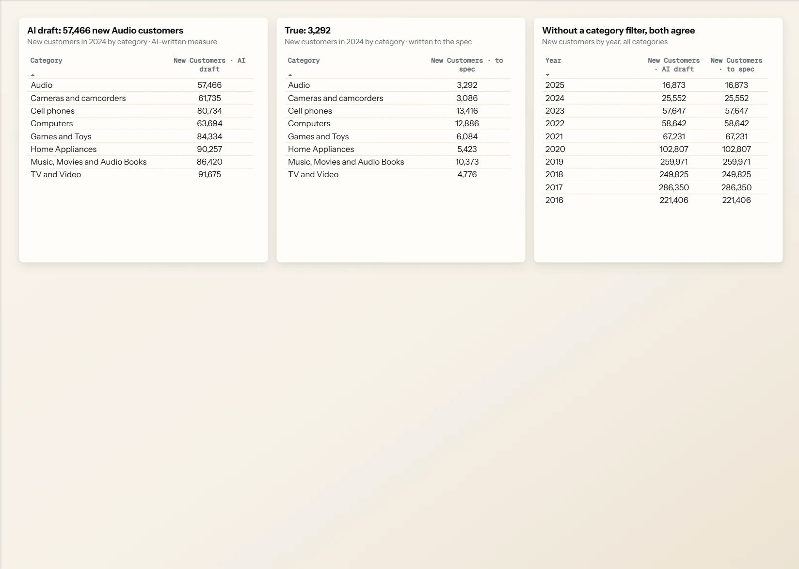

# AI-written DAX on 10M rows: is it right, and is it fast?

Two AI models each wrote 8 common DAX measures from plain-English specs, once, without seeing the data.
Checked against values computed from 23.7M sales rows and timed on a report grid.

**Finding:** most measures were right, but both drafts counted "new customers" per category instead of ever:
57,466 new Audio customers in 2024 where the true number is 3,292. Nothing errors, and every total looks right.
One draft's version took about 4.2 minutes and about 12 GB of memory to fill an 80-cell grid; a measure written to
the spec took 1.5 seconds.

Full method and numbers: [evidence.md](evidence.md). Raw numbers: [results.json](results.json).

## Reproduce it

1. Download the Contoso V2 sample from SQLBI (MIT licence):
   [ready-to-use-data release](https://github.com/sql-bi/Contoso-Data-Generator-V2-Data/releases/tag/ready-to-use-data), parquet, 10M set.
2. Load it into a Power BI model with tables Sales, Customer, Product, Store and Date (marked as date table) and
   relationships Sales to Customer, Product and Store on their keys, and Sales[Order Date] to Date[Date]. Convert the parquet dates without the time zone (see evidence.md).
3. Run `tests/expected.dax`, then each `tests/test-*.dax`, in DAX query view and compare.

| File | What it is |
|---|---|
| `dax/prompt.md` | The exact prompt both AI sessions got |
| `dax/draft-sonnet.dax`, `dax/draft-haiku.dax` | Their answers, unedited |
| `dax/reference.dax` | Measures written to the literal spec |
| `tests/` | Expected values from the rows, and one test query per version |
| `journal.json` | Every step, in order |

Data: Contoso V2 sample, SQLBI, MIT licence. Tested 2026-11-21 in Power BI Desktop 2.159.1231.0.
