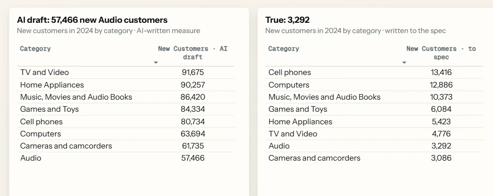
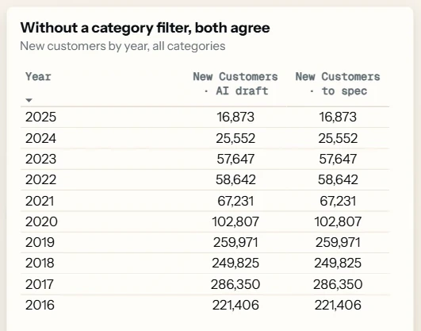

# Evidence: AI-written DAX on 10M rows

Tested on 2026-11-21 in Power BI Desktop 2.159.1231.0 (Import mode), on the Contoso V2 sample from SQLBI (MIT),
10M-order set: 23,719,935 sales lines, 9,887,613 orders, 1,346,304 customers, orders from 2016-05-18 to 2025-12-31.

## Question

When an AI writes DAX measures from plain-English specs, how many return correct values, and how fast are they
compared with a measure written to the spec?

## Setup

- **Drafts.** Two fresh AI sessions wrote all 8 measures once, from the same prompt (`dax/prompt.md`): Claude Sonnet and
  Claude Haiku, through Claude Code 2.1.314 in print mode, with no tools and an empty working folder. They saw the
  table and column names and the specs, never the data or the tests. Drafts are unedited: `dax/draft-sonnet.dax`,
  `dax/draft-haiku.dax` (written 2026-11-21T18:44:57Z).
- **Reference.** One version written to the literal spec: `dax/reference.dax`.
- **Expected values.** Computed from the rows with a different technique (GROUPBY for each customer's first purchase,
  plain date filters on Sales, no time-intelligence functions): `tests/expected.dax`, values in `tests/expected.json`.
- **Contexts.** 5: year 2024; 2024 with Category = Audio; March 2024; 2024 with customer country Germany; year 2017.
  8 measures x 5 contexts = 40 checks per version.

## Results

| | Sonnet draft | Haiku draft | Reference |
|---|---|---|---|
| Correct checks as written | 33 of 40 | 33 of 40 | 40 of 40 |
| Measures that don't compile | 1 | 1 | 0 |
| Correct after renaming one variable | 38 of 40 | 38 of 40 | |

- **The compile error.** Both drafts name a variable `LastDate` in Sales 30D Avg. LASTDATE is a DAX function, so the
  measure does not compile. After renaming that one variable, both versions return the expected values.
- **The wrong numbers.** With a category filter, both drafts treat "first purchase ever" as "first purchase in this
  category". For 2024 with Category = Audio, both return 57,466 new customers; the true number is 3,292.
  Returning customers: both return 98,489; the true number is 152,663.
- **Across a report grid** (Year x Category, 80 cells), the Haiku draft's # New Customers is wrong in 72 of 80 cells.
  Examples: 2024 Computers 63,694 against 12,886; 2025 TV and Video 49,662 against 1,994. The only correct cells
  are the 8 cells of 2016, the first year, when every customer is new.
- Without a category filter (2024, March 2024, Germany, 2017) every draft measure that compiles returns the expected value.

### New customers in 2024 by category (the report page and the post image)

Each measure in its own query and its own table visual, Year = 2024, both tables sorted by category A to Z. Screenshot
of the Power BI Desktop page used in the post image (recaptured 2026-11-22 after sorting both tables A to Z; numbers
re-run by DAX the same day, unchanged): `media/ai-vs-spec-two.webp`. Full page: `media/ai-vs-spec-desktop.webp`.

| Category | AI draft (Haiku) | Written to spec |
|---|---|---|
| Audio | 57,466 | 3,292 |
| Cameras and camcorders | 61,735 | 3,086 |
| Cell phones | 80,734 | 13,416 |
| Computers | 63,694 | 12,886 |
| Games and Toys | 84,334 | 6,084 |
| Home Appliances | 90,257 | 5,423 |
| Music, Movies and Audio Books | 86,420 | 10,373 |
| TV and Video | 91,675 | 4,776 |

The written-to-spec values match the row-level check (GROUPBY over all sales lines) for every category tested.

### New customers by year, no category filter (the lower table in the post image)

Both measures and the row-level check (each customer's first-ever order date, from GROUPBY over all sales lines),
checked on 2026-11-21 for every year:

Screenshot of this table on the same Power BI Desktop page, used in the post image: `media/ai-vs-spec-year.webp`.

| Year | AI draft (Haiku) | Written to spec | From the rows |
|---|---|---|---|
| 2025 | 16,873 | 16,873 | 16,873 |
| 2024 | 25,552 | 25,552 | 25,552 |
| 2023 | 57,647 | 57,647 | 57,647 |
| 2022 | 58,642 | 58,642 | 58,642 |
| 2021 | 67,231 | 67,231 | 67,231 |
| 2020 | 102,807 | 102,807 | 102,807 |
| 2019 | 259,971 | 259,971 | 259,971 |
| 2018 | 249,825 | 249,825 | 249,825 |
| 2017 | 286,350 | 286,350 | 286,350 |
| 2016 | 221,406 | 221,406 | 221,406 |

Without a category filter, both measures agree with the rows in every year from 2016 to 2025.

## Speed: # New Customers on the 80-cell grid

Cold cache (ClearCache before the run), server duration and peak memory from the engine's execution metrics:

| | Duration | Peak memory |
|---|---|---|
| Sonnet draft | 254,378 ms (about 4.2 minutes) | about 12,334 MB |
| Haiku draft | 5,312 ms | about 1,440 MB |
| Reference | 1,482 ms | about 379 MB |

Repeat runs, client-side time: Haiku 5,237 ms cold and 2,183 ms warm; reference 786 ms cold and 1,377 ms warm.
Sonnet's grid ran once and was not repeated, because it held about 12 GB of memory for over 4 minutes.
Not tested: 5 cold and 5 warm runs per version, other measures' timings, DirectQuery or Direct Lake.

Why the Sonnet draft is slow: it iterates every customer in the model (about 1.35M) for each cell, and runs a
context transition per customer; 97% of its time was formula engine. The reference filters only the customers in
the cell and finds each first purchase with ALLEXCEPT on the customer key; 87% of its time was storage engine.

## What surprised

- Two different models made the same business-rule mistake and the same compile error.
- The wrong numbers only appear when a second filter (category) is on. Every total and every year-level check passed.

## Found on the way: dates one day early

The first build of the base model read the parquet dates as UTC timestamps and converted them to the PC's local time
(US Central), so every date landed one day early: the Date table ran from 2015-12-31 to 2026-12-30 while its Year
column said 2016 to 2026. Before the fix, Year = 2024 on the Date table summed 3,280,758,606.50 while the shifted order
dates in 2024 summed 3,283,485,913.06. After the fix both give 3,280,758,606.50, the correct 2024 total.
Fixed in `shared/contoso/build_base.py` by dropping the zone before the date conversion. All results above are from
the fixed model.

## Sources

- SQLBI, Contoso Data Generator V2 data, release ready-to-use-data: https://github.com/sql-bi/Contoso-Data-Generator-V2-Data
- Microsoft Learn, LASTDATE function (DAX): https://learn.microsoft.com/dax/lastdate-function-dax

## Open issue (found 2026-11-21, under investigation, not yet a claim)

On the real report page, the written-to-spec measure showed 9,819 new Audio customers for 2024, not 3,292.
Reproduced in DAX against the same model in Power BI Desktop 2.159.1231.0:

- `SUMMARIZECOLUMNS ( Product[Category], TREATAS ( { 2024 }, 'Date'[Year] ), "spec", [New Customers · to spec] )` returns 3,292 for Audio.
- The same query with `[New Customers · AI draft]` added as a second column returns 9,819 for the spec measure (either column order).
- The row-level check (GROUPBY over all 23.7M lines) gives 3,292.

So the spec measure's value depends on which other measure is in the same query. Until this is understood (a
fault in the measure, or in how the engine evaluates the two together), the report page shows each measure in its own visual (one query each), which matches the row-level check,
and no post uses this behaviour as a finding.
